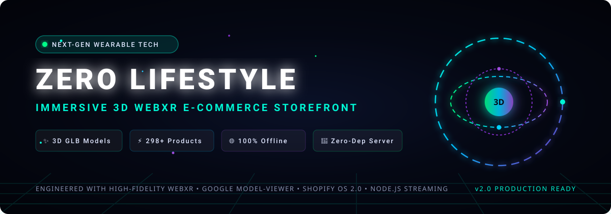
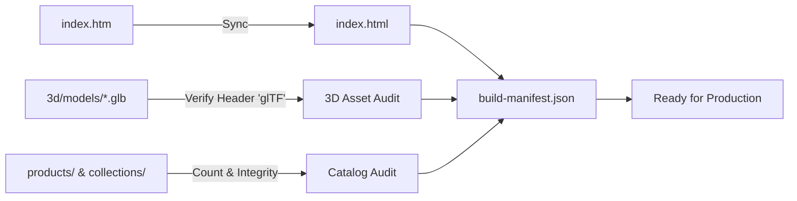

<div align="center">

<!-- ANIMATED HERO BANNER -->


<br/><br/>

<!-- BADGES ROW 1: PLATFORM & ARCHITECTURE -->
[](#-interactive-3d-webxr-experience)
[](server.js)
[](https://zerolifestyle.co)
[](#-zero-dependency-streaming-server)
[](#-license)

<!-- BADGES ROW 2: STATUS & COMPATIBILITY -->
[](#-build--health-verification)
[](products/)
[](collections/)
[](3d/models/7996311cf3ce7e1e/Display_GLB.glb)
[](#-key-features)

<br/>

<h3>⚡ The Future of Wearables • Re-Engineered with Interactive 3D WebXR ⚡</h3>

<p align="center">
  <b>Zero Lifestyle</b> (<code>zerolifestyle.co</code>) is Pakistan’s #1 fastest-growing smart wearable and lifestyle audio brand. This repository contains the complete <b>offline-first, high-fidelity 3D e-commerce storefront</b>, powered by Google's <code>&lt;model-viewer&gt;</code> engine, rich responsive catalogs, and a native zero-dependency HTTP range-streaming dev server.
</p>

[🚀 Quick Start](#-quick-start) • [🕶️ 3D Experience](#-interactive-3d-webxr-experience) • [📂 Project Structure](#-folder-structure--architecture) • [🛠️ Build & Tests](#-build--health-verification) • [🌐 Deployment](#-deployment-guide)

</div>


## 🌟 Highlights & Key Features

<table align="center" width="100%">
  <tr>
    <td width="50%" valign="top">
      <h4>🕶️ Interactive 3D WebXR Showcase</h4>
      <ul>
        <li><b>Photorealistic GLTF/GLB Rendering</b>: Embedded <code>Display_GLB.glb</code> 3D model with real-time PBR lighting and materials.</li>
        <li><b>360° Touch & Mouse Orbit</b>: Full degree pitch, yaw, and zoom control with smooth momentum physics.</li>
        <li><b>Mobile AR Quick-Look</b>: Instant augmented reality projection on iOS (USDZ) and Android (SceneViewer).</li>
      </ul>
    </td>
    <td width="50%" valign="top">
      <h4>⚡ High-Speed Zero-Dep Dev Server</h4>
      <ul>
        <li><b>Native Node.js Engine</b>: Zero npm dependencies required to run the development server.</li>
        <li><b>HTTP Byte-Range Streaming</b>: Seamless streaming for 13MB+ 3D models and high-bitrate MP4 product video loops.</li>
        <li><b>Instant Clean Routing</b>: Auto-resolves root <code>/</code>, <code>index.html</code>, clean paths, and font query strings.</li>
      </ul>
    </td>
  </tr>
  <tr>
    <td width="50%" valign="top">
      <h4>🛍️ Comprehensive E-Commerce Catalog</h4>
      <ul>
        <li><b>298+ Product Pages</b>: Full landing pages with interactive swatches, specs, customer reviews, and video reels.</li>
        <li><b>119+ Collections</b>: Smartwatches, wireless earbuds, stainless steel/silicone straps, accessories & sales.</li>
        <li><b>Full Storefront Flow</b>: Integrated cart (<code>cart.html</code>), product search (<code>search.html</code>), and checkout previews.</li>
      </ul>
    </td>
    <td width="50%" valign="top">
      <h4>🎨 100% Offline Static Archive</h4>
      <ul>
        <li><b>Local Typography</b>: Preloaded Bricolage Grotesque, Hanken Grotesk, and Instrument Serif fonts in <code>s/</code>.</li>
        <li><b>Static Media Cache</b>: Over 38,000 CDN assets, responsive WebP image pipelines, and vector iconography.</li>
        <li><b>Shopify OS 2.0 Theme</b>: Complete compiled theme styles, vendor libraries (Bootstrap 5, Swiper 11, Locomotive).</li>
      </ul>
    </td>
  </tr>
</table>

<br/>

<!-- 3D FEATURE CARD -->
<div align="center">
  
</div>

<br/>


## 🕶️ Interactive 3D WebXR Experience

The flagship **Display Earbuds** experience utilizes Google's `<model-viewer>` component to render 3D assets directly in the browser with full WebXR and AR support:

```html
<!-- Interactive 3D Model Viewer Snippet -->
<model-viewer
  src="3d/models/7996311cf3ce7e1e/Display_GLB.glb"
  camera-controls="true"
  auto-rotate="true"
  ar="true"
  ar-modes="webxr scene-viewer quick-look"
  camera-orbit="35.0deg 61.1deg 5.99m"
  camera-target="0.001m -0.167m -0.662m"
  field-of-view="45deg"
  exposure="1.0"
  shadow-intensity="1.2"
  style="width: 100%; height: 500px; background-color: transparent;"
  alt="Zero Lifestyle Display Earbuds 3D Model">
</model-viewer>
```

> **Live 3D Route**: When running the server, visit [`http://localhost:3000/products/display-earbuds.html`](http://localhost:3000/products/display-earbuds.html) to interact with the 3D model in real time!

<br/>


## 🚀 Quick Start

Get the entire storefront up and running locally in under **5 seconds** without installing heavy third-party packages:

### 1. Prerequisites
- **Node.js** v16.0.0 or higher installed.
- (Optional) Git for version control.

### 2. Launch Local Dev Server
```bash
# Clone or navigate into the workspace directory
cd zerolifestyle.co

# Launch the zero-dependency streaming development server
npm run dev
# or
node server.js
```

Storefront is now live at:
```text
======================================================
🚀 Zero Lifestyle Storefront Server is LIVE!
📡 Local URL:    http://localhost:3000
🎧 3D Product:   http://localhost:3000/products/display-earbuds.html
⌚ Smartwatches: http://localhost:3000/pages/smart-watches.html
🛍️  Cart:         http://localhost:3000/cart.html
======================================================
```

### 3. Production Build & Audit
```bash
# Run build pipeline: audits assets, synchronizes indexes, verifies 3D GLB magic bytes
npm run build
```

### 4. Automated Integrity & Health Test
```bash
# Run integrity test to ensure all 14+ critical routes & media exist
npm run verify

# Run end-to-end HTTP endpoint test
npm test
```

<br/>


## 📂 Folder Structure & Architecture

```text
zerolifestyle.co/
├── 3d/                                  # 🧊 3D WebXR Assets
│   └── models/7996311cf3ce7e1e/
│       └── Display_GLB.glb              # High-fidelity 13.58 MB GLB 3D model
├── assets/                              # 🎨 Project Visuals & Documentation
│   └── readme/                          # Animated SVGs, Banners, and Dividers
├── collections/                         # 🗂️ 119+ Product Collection Pages
│   ├── platinum-series-products.html    # Flagship smartwatches
│   ├── wireless-earbuds.html            # Audio products
│   └── straps-accessories.html          # Bands and chargers
├── products/                            # 🛍️ 298+ Product Detail Pages
│   ├── display-earbuds.html             # Flagship 3D model product page
│   ├── regal-smartwatch.html            # AMOLED Bluetooth calling watch
│   └── legacy-smartwatch.html           # Luxury classic timepiece
├── pages/                               # 📄 38+ Editorial & Brand Pages
│   ├── smart-watches.html               # Product category landing page
│   ├── about-us.html                    # Brand story
│   ├── warranty-policy.html             # 1-Year replacement warranty
│   └── track-order.html                 # Logistics tracking
├── blogs/                               # ✍️ Wearables Tech & Lifestyle Articles
├── cdn/                                 # 📦 38,000+ Cached Shopify CDN Assets
│   └── shop/t/55/assets/                # Theme CSS, JS bundles, and icons
├── videos/                              # 🎬 67 Promotional MP4 Product Loops
├── s/                                   # 🔤 Local Google Fonts (TTF & WOFF2)
├── ajax/                                # 🔄 Cart & Localization Mocks
├── npm/                                 # 📚 Vendor Libraries (Bootstrap, Swiper)
├── scripts/                             # ⚙️ Automation & Pipeline Scripts
│   ├── build.js                         # Build & asset synchronization
│   ├── verify.js                        # File integrity validator
│   └── test-server.js                   # HTTP endpoint regression test
├── .gitignore                           # 🛡️ Git hygiene rules
├── build-manifest.json                  # 📋 Generated build audit manifest
├── cart.html                            # 🛒 Interactive Shopping Cart
├── search.html                          # 🔎 Instant Product Search
├── index.html                           # 🏠 Primary Web Entry Point
├── index.htm                            # 🏠 Mirror Root Document
├── package.json                         # 📦 NPM Package Manifest & Scripts
└── server.js                            # 🚀 Native Range-Streaming HTTP Server
```

<br/>


## 🛠️ Build & Health Verification

The repository includes a dedicated build and testing pipeline to guarantee that all assets, routes, and 3D files remain intact:



### Build Commands Matrix

| Command | Action | Output / Target |
|:---|:---|:---|
| `npm run dev` | Starts local streaming HTTP server | Serves at `http://localhost:3000` |
| `npm run build` | Syncs root indices, audits structure & validates GLB header | Generates `build-manifest.json` |
| `npm run verify` | Performs structural sanity check across all core files | Terminal status report |
| `npm test` | Automated HTTP GET requests to test endpoints & status codes | Response validation |

<br/>


## 🌐 Deployment Guide

### Deploying to GitHub Pages
1. Push this repository to your GitHub account:
   ```bash
   git init
   git add .
   git commit -m "feat: initial commit of Zero Lifestyle 3D storefront"
   git remote add origin https://github.com/<your-username>/zerolifestyle.co.git
   git branch -M main
   git push -u origin main
   ```
2. In your GitHub repository, navigate to **Settings > Pages**.
3. Under **Build and deployment > Source**, select **Deploy from a branch**.
4. Set branch to `main` and directory to `/ (root)`. Click **Save**.
5. Your 3D storefront will be live within seconds!

### Deploying to Netlify or Vercel
- **Build Command**: `npm run build`
- **Publish Directory**: `.` (Root)

<br/>


## 💎 Product Showcase Matrix

<details>
<summary><b>⌚ Click to view featured Smartwatches catalog</b></summary>
<br/>

| Model | Display | Special Features | Status |
|:---|:---|:---|:---|
| **Regal Smartwatch** | 1.96" Ultra AMOLED | Stainless Steel Bezel, BT Calling, 100+ Sports | Active |
| **Legacy Smartwatch** | 1.43" HD AMOLED | Classic Round Dial, Always-On Display | Active |
| **Orbit Smartwatch** | 1.39" Curved Glass | Dual-Strap Combo, Health Suite 2.0 | Active |
| **Terra Smartwatch** | Rugged Outdoor Screen | Military Grade IP68 Water Resistant | Active |
| **Vogue Smartwatch** | Slim Aesthetic Bezel | Women's Health Tracker, Metallic Straps | Active |

</details>

<details>
<summary><b>🎧 Click to view featured Wireless Audio catalog</b></summary>
<br/>

| Model | Audio Drivers | 3D Model | Battery Life |
|:---|:---|:---:|:---|
| **Display Earbuds** | 13mm Titanium Quad Drivers | [✅ Interactive 3D](products/display-earbuds.html) | 50 Hours ANC |
| **Wave Earbuds** | Deep Bass Neodymium | ✅ High-Res | 40 Hours Fast Charge |
| **Sonic Pods** | Ultra-Low 35ms Latency Gaming | ✅ High-Res | 36 Hours RGB Case |

</details>

<br/>


## 👨‍💻 Author & Credits

- **Original Storefront & Brand**: [Zero Lifestyle](https://zerolifestyle.co)
- **3D Engineering & Architecture**: **Hammad**
- **Repository Optimization & Pipeline**: Engineered with high-performance Node.js streaming & modern WebXR standards.

---

<div align="center">
  <sub>Built with passion for next-generation web & wearable experiences. All trademarks and brand assets belong to their respective owners.</sub>
</div>
